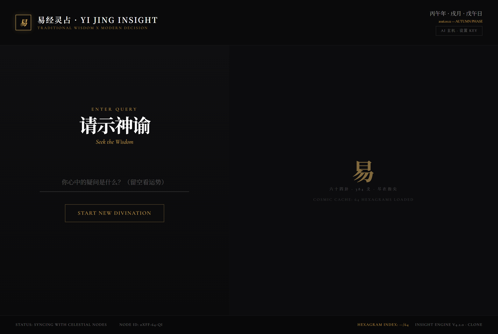
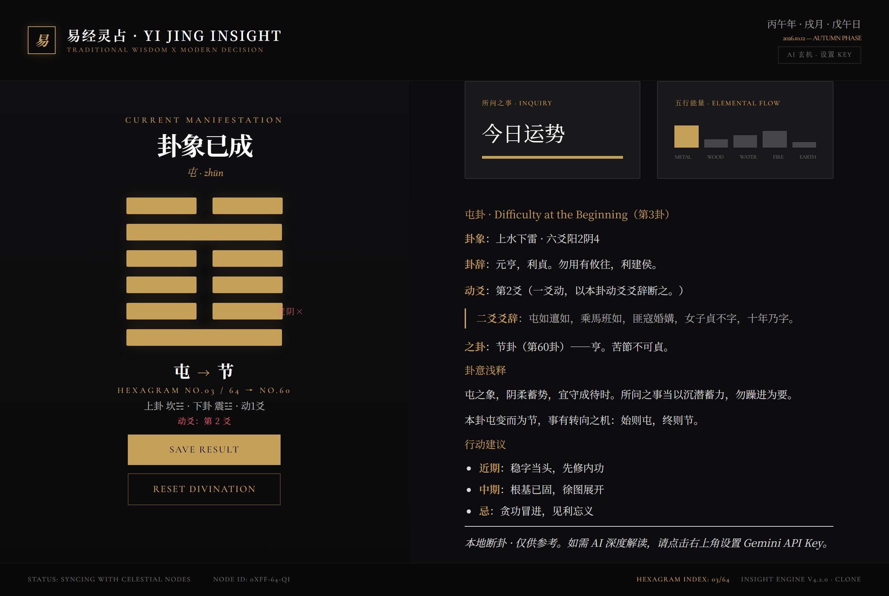

<div align="center">

# 🎴 易经灵占 · YI JING INSIGHT

**三枚铜钱起卦，六十四卦纳于指尖 —— 本地断卦引擎离线即用，接入 Gemini 解锁 AI 玄机推演**

*An AI-powered I Ching divination web app in a single HTML file — cast hexagrams with the three-coin method, and unlock Gemini-powered readings.*


**🔮 在线直接开卦 → [way227.github.io/yijing-insight](https://way227.github.io/yijing-insight/)**

**请示神谕 · Seek the Wisdom**



| 卦象已成 | 断卦解读 |
|---|---|
|  | 六爻卦象可视化，本卦 → 之卦一目了然 |

</div>

---

在心里默念所问之事，摇出六爻，得到一卦：卦辞、动爻、之卦、五行能量、行动建议一屏尽览。**不配任何 Key 也能玩**——内置《周易》本地断卦引擎；想要更深的解读，在右上角填一个 Gemini API Key 即可，Key 只存在你自己的浏览器里。

## ✨ 特性

- 🎲 **三枚铜钱起卦** —— 还原传统摇卦：三枚铜钱合 6/7/8/9 定阴阳老少，六爻自下而上成卦，可留空问今日运势
- 🧠 **本地断卦引擎** —— 按「本卦 / 动爻 / 之卦」与朱熹变占规则自动取断，输出卦象总览、动爻详解、行动建议，**完全离线可用**
- ✨ **Gemini 玄机推演（可选）** —— 填入 API Key 后由 Gemini 深度解卦；支持两条通道：本地中转（`server.py`，自动探测系统代理）或浏览器直连 Google
- 📜 **六十四卦全数据** —— 卦名、拼音、英译、卦辞、爻辞、上下卦全部内置，单文件即含全部经文
- 🖼️ **卦签留影** —— 一键把卦象与解读渲染成图片保存（html2canvas）
- 🌗 **干支纪时** —— 顶部实时显示四柱干支与节气阶段，仪式感拉满
- 🚀 **零构建、零依赖** —— 前端就一个 `index.html`（由 `build.py` 注入数据生成）；服务端是纯 Python 标准库的单文件

## 🚀 快速开始

### 方式零 · 在线玩（什么都不用装）

打开 **[way227.github.io/yijing-insight](https://way227.github.io/yijing-insight/)** 即可开卦：本地断卦 + 直连 Gemini 全部可用。

### 方式一 · 直接打开（最简单）

双击 `index.html` 即可开卦：本地断卦、浏览器直连 Gemini 全部可用，无需安装任何东西。

### 方式二 · 本地中转（推荐需代理的网络环境）

```bash
python server.py
# 打开 http://127.0.0.1:8763
```

服务器自动探测 Windows 系统代理（或 `HTTPS_PROXY` 环境变量），由 Python 侧转发 Gemini 请求，浏览器无需直连 Google。纯标准库实现，`pip install` 都不用。

### 方式三 · 免费静态托管

把 `index.html` 上传到 GitHub Pages / Netlify Drop 等任意静态托管，得到一个网址，手机电脑随处可占。

### 🔑 配置 Gemini（可选）

1. 到 [Google AI Studio](https://aistudio.google.com/apikey) 免费领取 API Key
2. 点击页面右上角 **「AI 玄机 · 设置 KEY」** 粘贴保存

> Key 仅保存在本机浏览器 `localStorage`；直连模式下解读请求由你的浏览器直达 Google，额度走你自己的免费配额。不填则使用内置本地断卦。

## 🧠 断卦逻辑

```
三枚铜钱 × 6 次 ──► 六个爻值(6/7/8/9) ──► 本卦 + 动爻 + 之卦
                                          │
                            朱熹变占规则取断（0~6 爪动各有所主）
                                          │
              ┌───────────────────────────┴──────────┐
        无 Key：本地断卦引擎                     有 Key：Gemini 深度解读
   （卦象总览 / 动爻详解 / 行动建议）      （卦象总览 / 动爻详解 / 之卦转向 / 行动建议）
```

## 📁 项目结构

```
├── index.html            # 主应用（构建产物，双击即玩）
├── server.py             # 本地中转服务器（纯标准库，含 Gemini 代理 + 静态托管）
├── build.py              # 构建脚本：把卦数据注入模板生成 index.html
├── hexagrams2.min.json   # 六十四卦数据（卦名/拼音/英译/卦辞/爻辞…）
├── jing_full.json        # 周易经文全文
├── bin64.json            # 卦序 ↔ 二进制爻位映射
└── docs/                 # 截图
```

## 🛠️ 改完代码怎么重新构建

改 `build.py` 里的模板（界面与逻辑都在里面）后：

```bash
python build.py    # 重新生成 index.html
```

## ⚠️ 免责声明

本项目仅用于**传统文化体验与娱乐**，卦象解读不构成任何现实决策建议。问事业问姻缘，终究不如问自己。

## 🙏 致谢

- 灵感与玩法还原自 Google AI Studio 上一款易经占卜应用，感谢原作者的巧思
- 《周易》卦爻辞为公有领域古籍；界面基于 [Tailwind CSS](https://tailwindcss.com)、[marked](https://github.com/markedjs/marked)、[html2canvas](https://html2canvas.hertzen.com)

## 🤝 贡献

欢迎提 Issue 和 PR！改 `build.py` 模板后跑一遍 `python build.py` 即可，无其他构建步骤。开发细节与项目地图见 [AGENTS.md](AGENTS.md)。

## 📄 License

[MIT](LICENSE) © 2026 WAY227

<div align="center">大衍之数五十，其用四十有九。 🎴</div>
